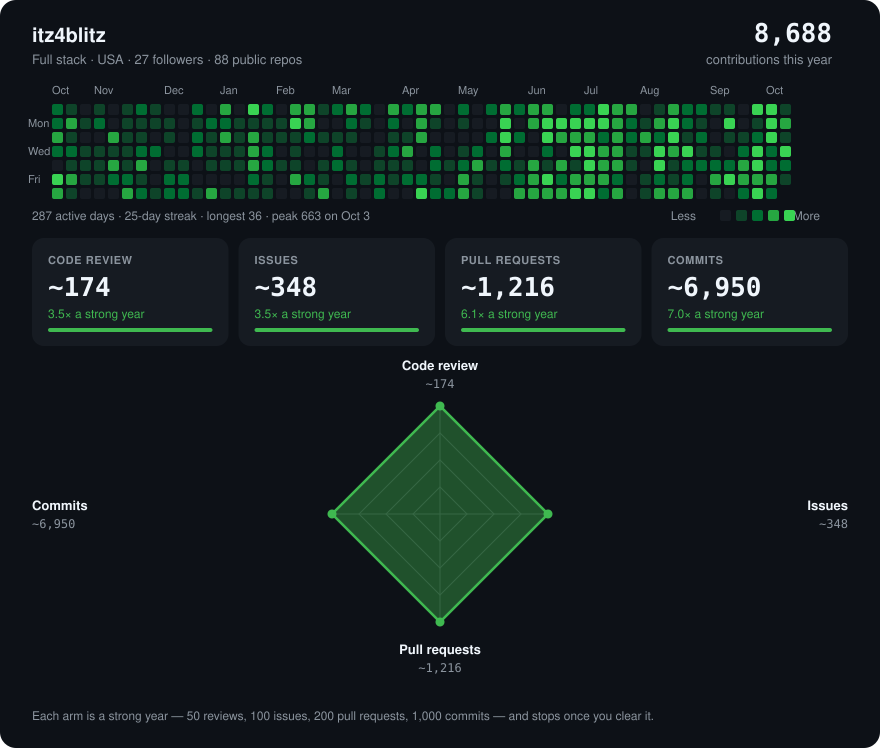

Full-stack engineer. Rust and TypeScript, Go when the job is a CLI. Local-first software, media systems, and the tooling around AI coding agents.

The chart scores each kind of work against a strong year: 50 reviews, 100 issues, 200 pull requests, 1,000 commits. GitHub's own activity diamond plots share of the total, so commits take that shape.

## Now

- **[tinyclient](https://github.com/itz4blitz/tinyclient)** — a native app for Discord, Slack, Signal, Teams, and Telegram. [tinyclient.io](https://tinyclient.io)
- **[Gunmetal](https://github.com/itz4blitz/gunmetal)** — media server and player. Files play as they are. [gunmetal.tv](https://gunmetal.tv)
- **[Logarr](https://github.com/itz4blitz/Logarr)** — logs from your servers, with issues ranked by impact.
- **[Premier](https://github.com/itz4blitz/premier)** — local-first flight recorder for AI agent sessions.
- **[acidtest](https://github.com/itz4blitz/acidtest)** — mutation testing as a ledger lookup. Same answer as the full run, without redoing the work.

## Agent tooling

- **[ai-tools](https://github.com/itz4blitz/ai-tools)** — one set of MCP servers, skills, agents, rules, and hooks across coding tools.
- **[ArcInfer](https://github.com/itz4blitz/ArcInfer)** — encrypted sentiment classification. The text goes in, only the result comes out. [arcinfer.pages.dev](https://arcinfer.pages.dev)
- **[mcp-linear](https://github.com/tacticlaunch/mcp-linear)** — Linear from an assistant.

## Also

**[anonymizer](https://github.com/itz4blitz/anonymizer)** masks PHI and PII on a page for demos, with realistic stand-ins or a blur.

Rust, TypeScript, Go, Python.
